<picture>
  <source media="(prefers-color-scheme: dark)" srcset="docs/readme/hero-dark.svg">
  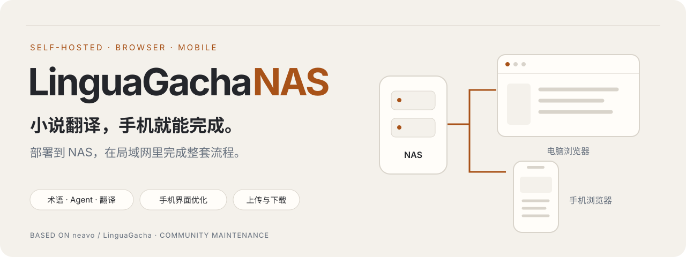
</picture>

<h1 align="center">LinguaGacha NAS</h1>

<p align="center">
  <strong>部署到 NAS，在局域网里用手机完成小说翻译。</strong><br>
  从上传原稿、整理术语，到 Agent 协作、翻译与下载，<br>
  一套流程在同一个界面完成，无需守在电脑前。
</p>

<p align="center">
  <a href="#界面一览">界面一览</a> ·
  <a href="#开始使用">开始使用</a> ·
  <a href="#访问最佳实践">访问方式</a> ·
  <a href="#功能支持范围">支持范围</a> ·
  <a href="#部署到-nas">NAS 部署</a> ·
  <a href="#维护计划">维护计划</a>
</p>

> 基于官方 **0.125.0**（`MANUAL_BUILD_v0.125.0`，提交 `7956576`）。本仓库是面向 NAS 与手机使用的维护分支，已包含服务器部署、文件管理器和手机界面改进。

## 为什么维护这个版本

把 [LinguaGacha](https://github.com/neavo/LinguaGacha) 的核心翻译能力带到 NAS，让手机也能承担复杂的小说翻译任务。NAS 运行翻译服务，你在同一局域网内打开手机浏览器，就可以操作工程、整理术语、与 Agent 协作，并下载译文。

本版本围绕三件事做改进：

1. **核心翻译流程顺畅**：保留术语表、Agent 与翻译能力，让术语准备、翻译和结果检查衔接起来。
2. **为手机屏幕优化**：调整表格、输入区、标签页、侧栏和日志布局，让有限的屏幕空间用于常用操作。
3. **文件管理器贯穿始终**：上传原稿、选择文件或工程、预览成果、下载译文，都在应用中完成，省去反复进入 NAS 目录翻找文件。

## 界面一览

### 01 · 术语表、Agent 与翻译，连成一套流程

为小说整理人物、地名和专有名词，通过 Agent 协作处理翻译任务，在工作台查看进度、检查结果并生成译文。核心能力保留，整套操作可以从手机浏览器完成。

下面是实际使用中的 `Interlude.epub` 工程，展示翻译进度、文件状态和生成译文入口。

<p align="center">
  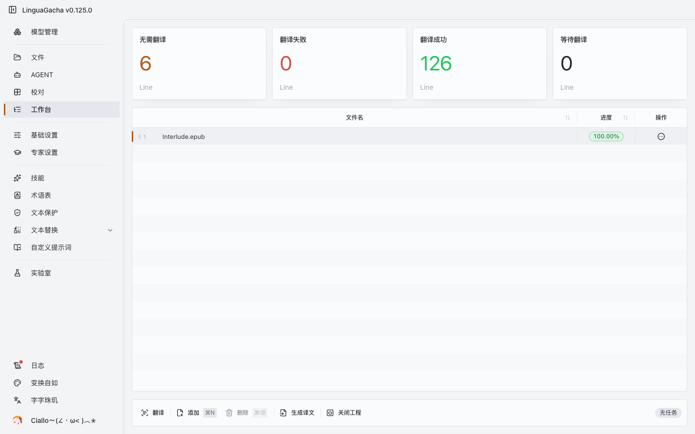
</p>

Agent 对话中的成果链接可以直接打开，支持预览 Markdown、TXT、JSON、CSV 等文本文件，并下载到本机。

<p align="center">
  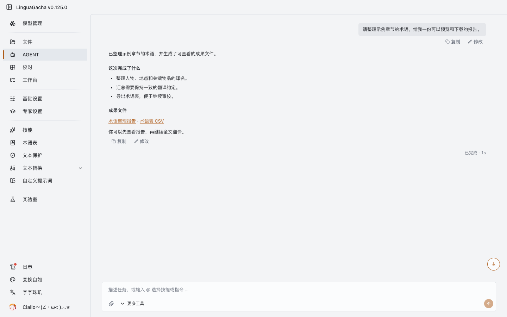
</p>

<details>
<summary><strong>查看 Agent 的 Markdown 成果预览</strong></summary>

<p align="center">
  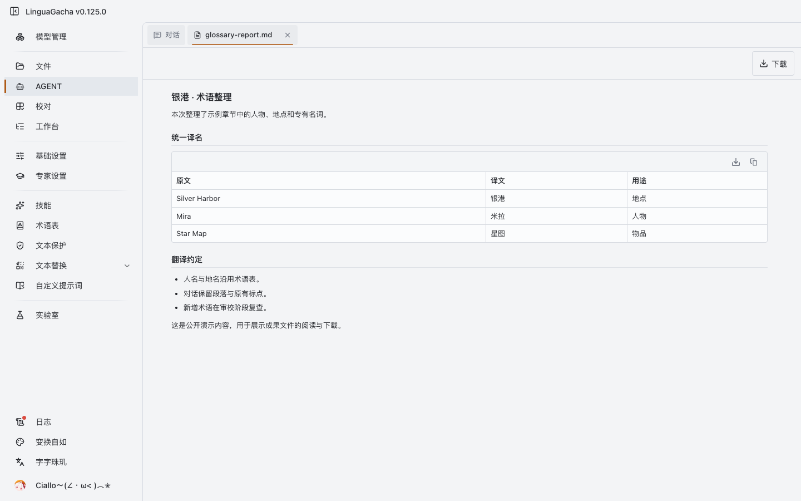
</p>

</details>

### 02 · 为手机屏幕重新整理界面

手机上的操作空间应当留给内容。术语表保留传统表格，默认只显示三列；日志把更多高度留给频繁滚动的列表。

<p align="center">
  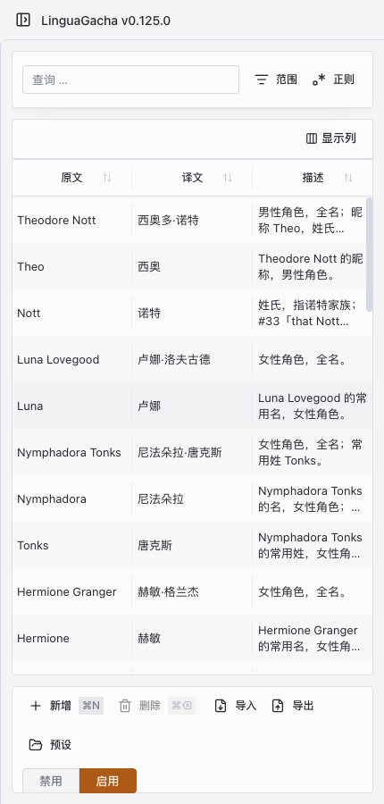&nbsp;
  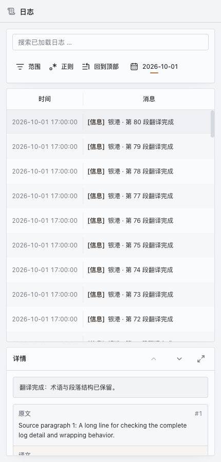
</p>

- **术语表**：文字缩小一号，「显示列」可自主选择，并保存偏好。
- **Agent**：输入框更紧凑，工具可折叠；「跟随最新」独立悬浮，文件标签更清楚。
- **侧栏与字体**：手机使用抽屉导航，全界面采用系统字体。
- **日志**：手机列表与详情约为 7:3，详情可展开细看；宽屏恢复左右排列。

### 03 · 文件管理器：上传到下载，都在同一个界面

新增的文件管理器连接起翻译前后两端：上传原稿后，通过目录浏览选择源文件或已有工程；生成译文后，在同一界面进入输出目录并下载。文件与成果有明确的下载入口，文本成果还可以先预览。

<p align="center">
  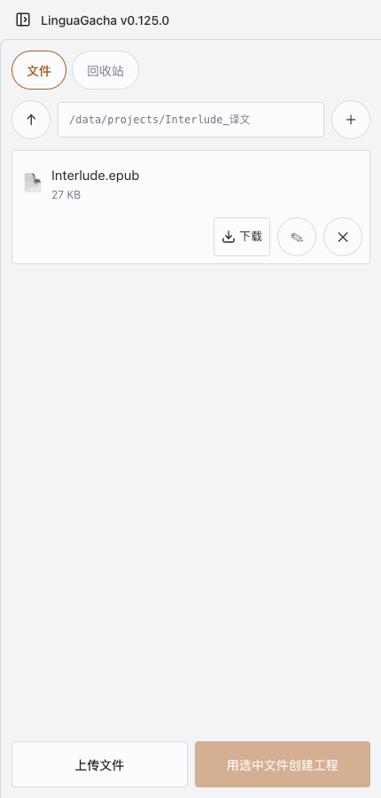
</p>

上传、选工程、翻译、下载，操作都留在翻译应用里，无需切换到 NAS 文件管理页面反复寻找文件。

<sub>工作台、手机术语表与译文目录来自实际工程，经所有者同意展示；Agent 对话与日志使用演示数据。截图未展示模型配置、密钥或登录信息。手机展示采用浏览器响应式模拟。</sub>

## 开始使用

部署完成后，首次使用先在「模型管理」配置模型接口，并在设置中选择原文和目标语言。之后，打开手机浏览器完成下面的流程。局域网内直接连接；外出时也可以通过下方介绍的飞牛远程服务访问。

<p align="center">
  
</p>

1. **上传原稿**：打开「文件」，上传待翻译的小说。
2. **选择工程**：浏览目录选择源文件并新建工程，或打开已有工程。
3. **整理术语**：按需提取人物、地名和专有名词，在术语表中检查和调整译名。
4. **翻译与审校**：通过 Agent 或工作台执行翻译，查看进度并检查结果。
5. **下载译文**：生成译文后，在文件页进入输出目录，点击下载按钮保存到手机。

Agent 提供的成果文件也可以点击链接，先预览，再下载。`.csv` 在这里指文本成果预览，不代表独立的 CSV 翻译格式。

## 访问最佳实践

部署在 **飞牛 NAS（fnOS）** 后，可以按所在网络和下载需求选择访问方式。下面的三种方式来自项目所有者的实际使用经验。

| 访问方式 | 上传、翻译与下载 |
| :--- | :--- |
| **局域网 · 浏览器直连** | 打开 `http://<NAS-IP>:8787`，在同一界面完成上传、翻译和下载。 |
| **远程 · 飞牛网页版** | 通过网页版飞牛远程服务进入 LinguaGacha，上传、翻译和浏览器下载都可以完成。 |
| **远程 · 飞牛 App 中转** | 可完成上传、Agent 协作和翻译；当前实测无法在 App 内直接下载，需要到 NAS 上的挂载目录取回译文。 |

### 在家：浏览器直接访问

手机与 NAS 处于同一局域网时，直接打开服务地址。上传小说、选择工程、整理术语、翻译和下载译文都在 LinguaGacha 内完成。

### 外出：网页版远程服务完成整套流程

如果希望在外也直接下载译文，可以从一开始就在手机浏览器中使用 **网页版飞牛远程服务** 进入 LinguaGacha。实际测试中，工作台、Agent 与文件管理器都可使用，译文可以通过文件页的下载按钮保存到手机。

<p align="center">
  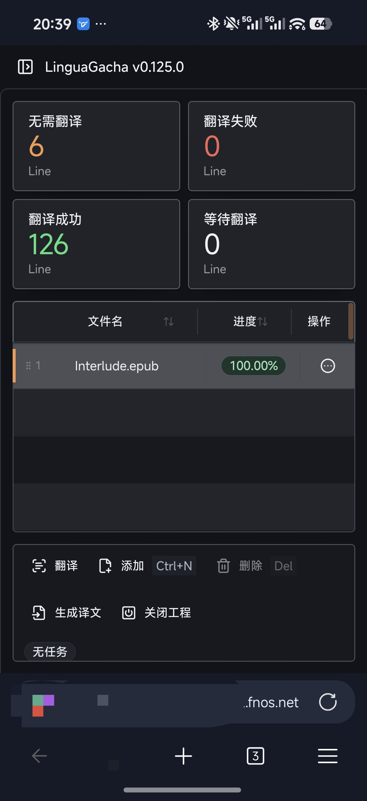&nbsp;
  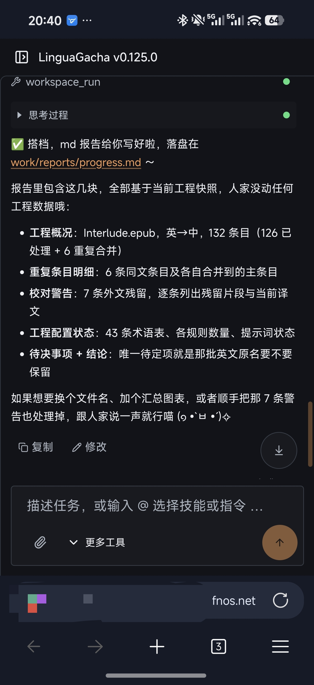&nbsp;
  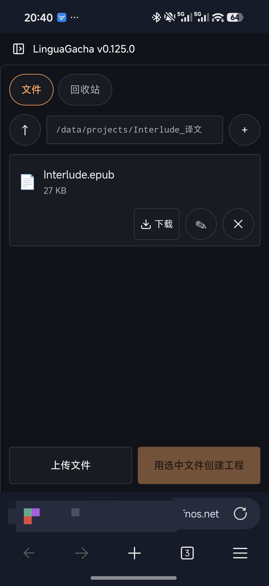
</p>

<p align="center"><sub>手机真机实测：翻译工作台 → Agent 协作 → 译文下载。截图中的个人远程地址已遮挡。</sub></p>

### 已在飞牛 App 中：翻译后从 NAS 目录下载

也可以通过飞牛 App 自带的中转服务进入应用。在「Docker」页面，从 `linguagacha` 容器的 `8787` 端口入口打开服务，即可上传原稿、操作工程和翻译。

> **App 内下载限制**：当前实测环境中，飞牛 App 内打开的页面无法直接下载文件。生成译文后，可以通过飞牛的文件管理功能进入 Docker 映射到 NAS 的目录，下载输出文件。

以本文 Compose 的 `./data:/data` 映射为例：

```text
应用里的译文路径
/data/projects/Interlude_译文/Interlude.epub

NAS 上对应的文件
<部署目录>/data/projects/Interlude_译文/Interlude.epub
```

先查看 `linguagacha` 容器映射到 `/data` 的 NAS 目录，再在飞牛 App 的「文件」中进入对应的译文子目录下载。实际目录以自己的 Docker 挂载配置为准。

<details>
<summary><strong>查看飞牛 App 的 Docker 服务入口</strong></summary>

<p align="center">
  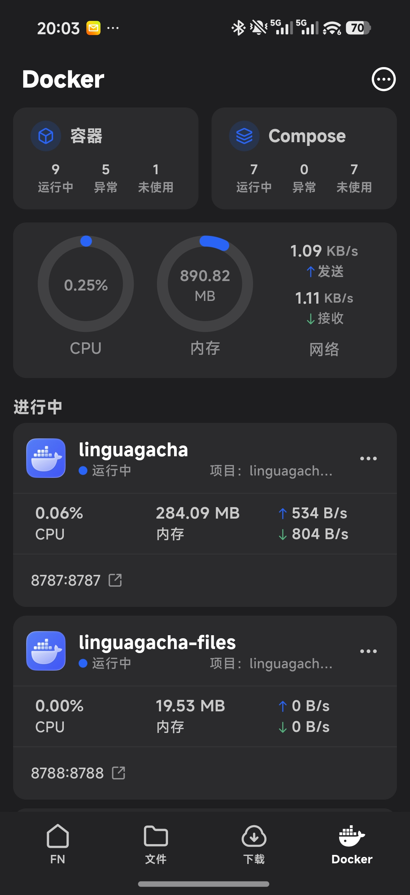
</p>

服务入口为 `linguagacha` 容器的 `8787` 端口。

</details>

<sub>远程访问与 App 下载限制来自项目所有者于 2026-10-01 的真机实测；本节截图保留实际工程内容，未展示 API key 或模型配置。</sub>

## 功能支持范围

本项目重点维护 **NAS 上的小说翻译流程、手机使用体验，以及应用内的文件上传下载**。

| 核心能力 | 当前支持 |
| :--- | :--- |
| 小说翻译 | EPUB、TXT 翻译、译文导出与浏览器下载已验证。 |
| 术语表 | 保留术语管理能力，支持手机三列表格与自选显示列。 |
| Agent | 保留对话协作能力，MD / TXT / JSON / CSV 成果支持预览和下载。 |
| 文件管理器 | 目录浏览、上传、文件与工程选择、成果下载。 |
| 手机界面 | 系统字体、紧凑输入区、折叠工具、抽屉侧栏与响应式日志。 |

<details>
<summary><strong>其他格式与支持边界</strong></summary>

- Markdown 保留上游翻译处理器，文本成果预览与下载已验证；翻译样式保留仍需专项样例验证。
- SRT、ASS、RPY、JSON、TRANS、XLSX 保留上游格式处理器，本维护版尚未逐格式完成端到端回归。
- **PDF 翻译不在本项目的支持与维护范围内。**
- 当前 NAS 版不支持 Agent 图片输入与视觉处理。

</details>

## 部署到 NAS

当前服务器镜像采用 **Node.js 24.17.0 + Docker**，通过 `8787` 提供网页和 API。已有部署在 Linux x86_64 / fnOS 上验证。

先取得本维护版源码，再构建 Docker 镜像：

```bash
git clone https://github.com/PureMilkchun/LinguaGacha.git
cd LinguaGacha
docker build -t linguagacha-nas:0.125-local .
```

仓库已提供 [compose.yaml](compose.yaml)，内容如下。`./data` 用于原稿、工程和输出；应用配置与日志使用命名卷保存。

```yaml
services:
  linguagacha:
    image: linguagacha-nas:0.125-local
    restart: unless-stopped
    ports:
      - "8787:8787"
    environment:
      LG_API_HOST: "0.0.0.0"
      LG_API_PORT: "8787"
      LG_FILES_ROOT: "/data"
    volumes:
      - ./data:/data
      - userdata:/app/userdata
      - logs:/app/log
    security_opt:
      - no-new-privileges:true
    cap_drop:
      - ALL

volumes:
  userdata:
  logs:
```

```bash
mkdir -p data
sudo chown 1000:1000 data
docker compose up -d
```

在同一局域网打开 `http://<NAS-IP>:8787`，然后配置模型接口。

<details>
<summary><strong>持久化、访问令牌与更新</strong></summary>

- 容器使用 UID `1000`，挂载的 `data` 目录需要允许该用户写入。示例中的属主设置用于新建目录。
- `userdata` 保存配置和应用数据，`logs` 保存运行日志；备份时也要包含 `data` 中的工程与输出。
- 示例沿用局域网无令牌配置。`LG_ACCESS_TOKEN` 可用于启用访问令牌。
- Agent 的临时对话与工作区成果不应当作持久备份。重建或重启容器前，先保存当前对话和成果文件。
- NAS 浏览器版已禁用官方桌面更新弹窗，版本更新通过更换部署镜像完成。
- 上面的镜像标签是本地构建示例；目前尚未发布公共镜像或独立维护版 Release。

</details>

## 维护计划

以官方 0.125 为起点，后续维护围绕 NAS 部署便利性、小说翻译流程和手机操作体验展开。

- [x] Node / Docker 服务器部署与浏览器桥接。
- [x] 目录浏览、文件上传、工程选择与浏览器下载。
- [x] 文本成果预览、三列术语表、系统字体和 Agent 界面整理。
- [x] 手机日志列表优先、宽屏左右布局和侧栏展开修正。
- [x] 建立 GitHub fork，保留官方 0.125 基线与上游历史。
- [ ] 建立 PR 自动检查、版本发布与镜像发布流程。
- [ ] 完善部署说明、持久化备份与更新回退流程。
- [ ] 持续验证 EPUB / TXT 的术语整理、Agent 协作、翻译与下载全流程。
- [ ] 扩充 Safari、手机 WebView 和不同屏幕比例的实际验证。

`main` 保存当前 NAS 维护版，`upstream-main` 保留建仓时的官方主分支。后续功能改动通过独立分支和 PR 合入；官方升级先在合并分支中验证，再发布部署版本。

开发与验证入口：

- [开发工作流](docs/WORKFLOW.md)：按改动范围选择检查与测试。
- [工程架构](docs/ARCHITECTURE.md)：了解代码与运行边界。
- [Agent 运行机制](docs/AGENT_RUNTIME.md)：了解对话、工具与工作区。

## 来源与使用说明

核心翻译能力来自 **[neavo / LinguaGacha](https://github.com/neavo/LinguaGacha)**。本维护版本围绕服务器和浏览器使用做改进，保留上游署名与现有使用要求。

上游 README 要求：使用 LinguaGacha 翻译时，在作品信息或发布页面说明；涉及商业行为或商业收益时，先联系原作者获得授权。完整原文保留在 [README_UPSTREAM.md](README_UPSTREAM.md)，具体以[官方 0.125 基线说明](https://github.com/neavo/LinguaGacha/blob/MANUAL_BUILD_v0.125.0/README.md)为准。

---

<p align="center"><sub>让 NAS 运行翻译，让手机完成操作。</sub></p>
